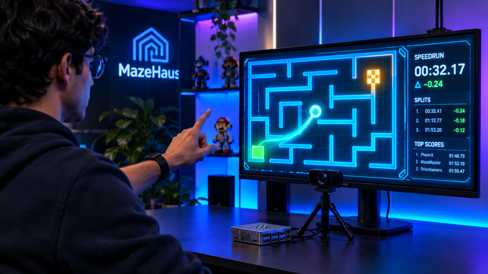
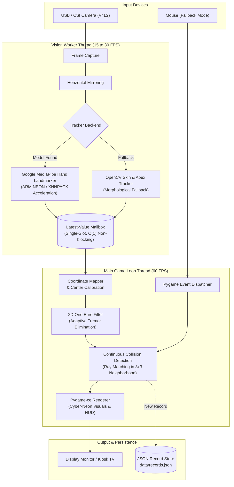
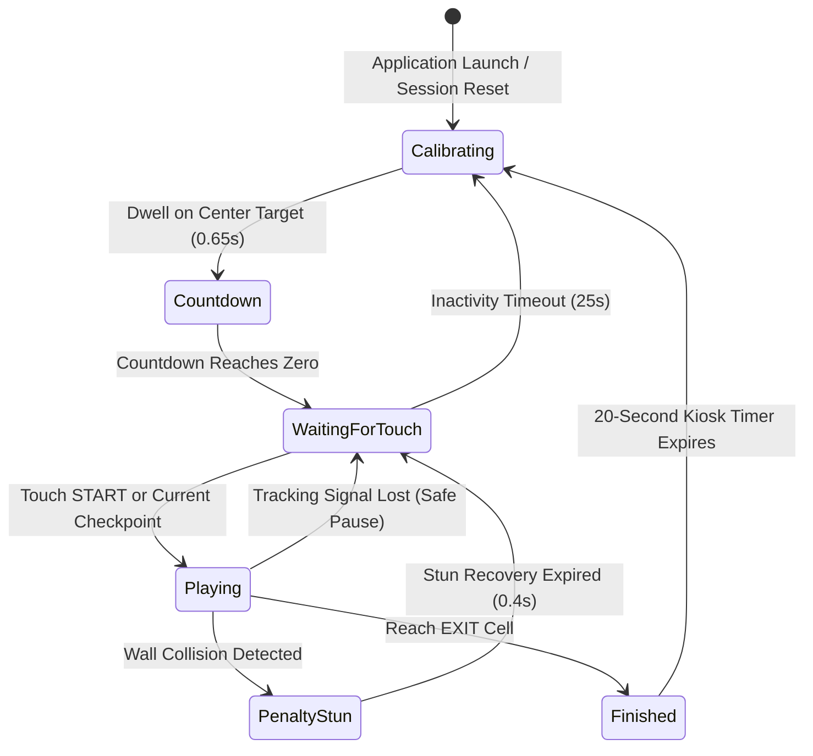

# MazeHaus



MazeHaus (also referred to as FingerMaze) is a touchless, computer-vision arcade maze game optimized to run natively on a Raspberry Pi 4. Players navigate an index finger in front of a camera to guide a luminous pointer through a labyrinth from entrance to exit. The objective is to achieve the fastest completion time while avoiding collisions with maze walls. The system maintains an all-time record leaderboard persisted locally.

## Architecture and Technical Design

The codebase adheres to a hexagonal (ports and adapters) architecture, ensuring pure domain logic remains isolated from I/O devices, rendering engines, and machine learning runtimes.



### Decoupled Concurrency Pipeline
- **Vision Worker Thread:** Continuously captures frames via OpenCV (`V4L2`), processes hand landmark inference at camera frame rates (15 to 30 Hz), and publishes lightweight snapshots into a lock-protected `LatestValueMailbox`. Frame buffer size is forced to 1 to eliminate queue buildup and input latency.
- **Rendering Thread:** Runs a fixed-timestep Pygame-ce game loop locked at 60 FPS. It reads the latest available pointer snapshot without blocking. If vision frames drop, rendering continues smoothly without jitter.

### Computer Vision Backends
- **Primary Tracker (Google MediaPipe):** Utilizes the MediaPipe Hand Landmarker task with XNNPACK CPU acceleration on ARM NEON architectures to extract 21 3D hand landmarks. Gesture heuristics distinguish an extended index finger from open-hand rests.
- **Fallback Tracker (OpenCV Spatial Skin Segmenter):** Operates without neural network weights in 1 to 3 ms on Raspberry Pi CPUs. Employs dual-color-space segmentation (HSV + YCrCb), CLAHE lighting normalization, morphological cleaning, spatial priors to exclude human faces, and apex clustering for sub-pixel fingertip tracking.
- **Mouse Fallback:** Seamless fallback mode for testing without video capture hardware.

### Signal Conditioning and Coordinate Mapping
- **Adaptive Filtering:** A 2D One Euro Filter dynamically adjusts cutoff frequencies based on fingertip velocity, eliminating high-frequency tremor while maintaining instant responsiveness during rapid movements. A noise deadband prevents micro-jitter when holding position.
- **Dynamic Center Calibration:** During the kiosk attract phase, dwelling in the central circle calibrates the user's natural resting hand position as the maze center point, preventing physical shoulder fatigue.

### Game State and Session Flow



### Game Physics and Scoring
- **Continuous Collision Detection (CCD):** Wall collisions are evaluated by continuous ray sampling between consecutive frame coordinates against neighboring wall segments (O(1) localized 3x3 grid query), preventing tunneling at high finger speeds.
- **Checkpoints and Stun Penalty:** Hitting a wall triggers a brief stun effect, resets the player to their last cleared checkpoint, and applies a configurable time penalty (default: 2.5 seconds).
- **Historic Speedrun Records:** Official scores account for raw completion time plus accumulated collision penalties. New records are atomically stored in `data/records.json`.

## Hardware Requirements

- **Processor:** Raspberry Pi 4 Model B (2 GB RAM or higher) or standard x86_64/ARM64 PC.
- **Camera:** Standard USB V4L2 webcam or Raspberry Pi Camera Module (CSI).
- **Display:** Monitor or TV running at 1280x720 or 1920x1080 resolution.

## Installation

The project uses `uv` for fast, reproducible dependency management.

1. Clone the repository:
   ```bash
   git clone https://github.com/AndresRuzTP/MazeHaus-Raspberry.git
   cd MazeHaus-Raspberry
   ```

2. Run the automated Raspberry Pi setup script:
   ```bash
   chmod +x scripts/setup_raspberry.sh
   ./scripts/setup_raspberry.sh
   ```

   Alternatively, install manually using `uv`:
   ```bash
   uv sync
   uv run python scripts/download_model.py
   ```

3. Verify environment and camera recognition:
   ```bash
   uv run python scripts/check_environment.py
   ```

## Running the Application

- **Standard Launch (Camera Vision):**
  ```bash
  uv run python -m fingermaze
  ```

- **Fullscreen Kiosk Mode:**
  ```bash
  uv run python -m fingermaze --fullscreen
  ```

- **Mouse Input Mode (Development / Headless):**
  ```bash
  uv run python -m fingermaze --mouse
  ```

- **Custom Maze Grid:**
  ```bash
  uv run python -m fingermaze --cols 16 --rows 10
  ```

### Controls and Shortcuts
- **Dwell on Center Circle:** Calibrates resting hand position and starts the 3-second countdown.
- **Touch Green Indicator:** Activates real-time movement tracing at the maze entrance or checkpoint.
- **R / C:** Reset current game session to calibration screen.
- **P:** Pause / Resume game.
- **ESC:** Quit application.

## Configuration

System parameters can be adjusted directly in `config.toml`:

```toml
[display]
width = 1280
height = 720
fullscreen = false
target_fps = 60

[camera]
device_index = 0
width = 640
height = 480
fps = 30
mirror = true

[tracking]
model_path = "models/hand_landmarker.task"
num_hands = 1
min_detection_confidence = 0.5
min_tracking_confidence = 0.5
hand_lost_timeout_s = 1.0
filter_min_cutoff = 1.0
filter_beta = 0.05

[maze]
cols = 10
rows = 7
wall_thickness = 6
cursor_radius = 14
wall_penalty_seconds = 2.5
```

## Testing and Verification

Run the test suite with coverage reporting:
```bash
uv run pytest --cov=fingermaze
```

Execute code formatting and static type checks:
```bash
uv run ruff check .
uv run mypy src tests
```
