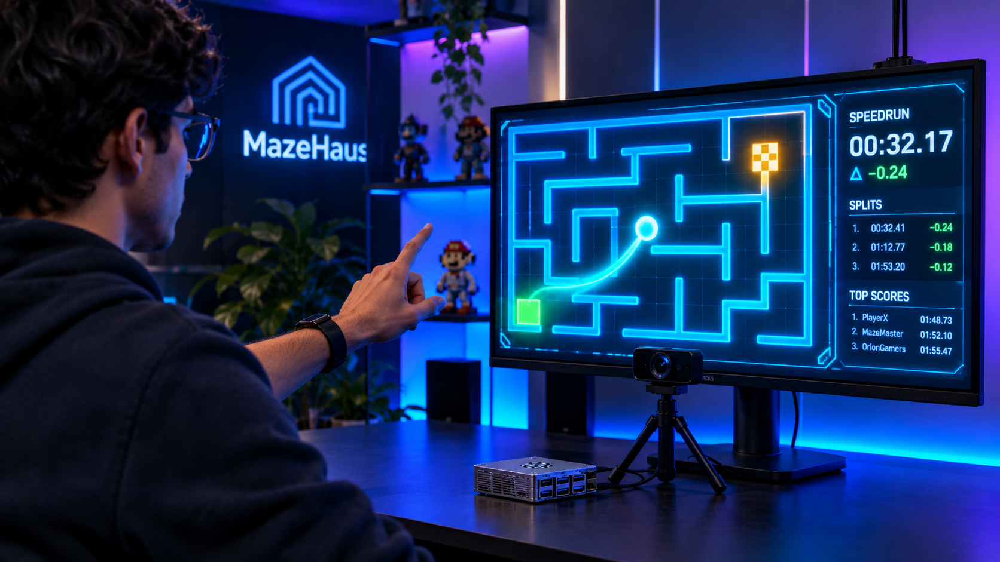

# MazeHaus



MazeHaus is a touchless computer vision arcade game designed for the Raspberry Pi 4 and modern desktop computers. Players guide an index finger in front of a camera to navigate a glowing pointer through an interactive maze. The goal is to reach the exit as quickly as possible while avoiding wall collisions and clearing checkpoints. Best times are saved to a local leaderboard.

## Key Features

* **Touchless Interaction:** Natural index finger tracking using Google MediaPipe Hand Landmarker with automatic fallback to an OpenCV skin tracker if model weights are not present.
* **Smooth Dual-Thread Architecture:** Hand tracking runs in a dedicated background worker thread at camera speed, while the Pygame display loop renders at a steady 60 frames per second with zero stutter.
* **Adaptive Motion Smoothing:** A dynamic One Euro filter removes hand tremors during subtle movements while maintaining instantaneous responsiveness during quick gestures.
* **Smart Calibration:** An initial center calibration step registers the natural resting position of the player hand, preventing shoulder strain during longer sessions.
* **Precise Physics:** Continuous collision detection catches fast movements across walls, applying configurable time penalties and resetting to the last cleared checkpoint.
* **Development Ready:** Instant mouse fallback mode makes it easy to test and debug on laptops without a camera.

## System Overview

```
Camera Input -> Background Vision Thread -> Lockless Mailbox -> Main Render Loop (60 FPS) -> Display
```

* **Vision Pipeline:** Captures webcam frames, applies horizontal mirroring, tracks index fingertip coordinates, and updates a single-slot mailbox with the latest detection.
* **Rendering Engine:** Polls input without waiting or blocking, maps coordinates to the maze arena, checks wall collisions, and updates particle effects and HUD elements.
* **Local Persistence:** Lap times and records are saved to `data/records.json` after every successful run.

## Quick Start

### Installation

Clone the repository and set up your virtual environment using Python 3.11 or 3.12:

```bash
git clone https://github.com/AndresRuzT/MazeHaus-Raspberry.git
cd MazeHaus-Raspberry
```

#### Using Standard Pip

```bash
python3 -m venv .venv
source .venv/bin/activate
pip install -r requirements.txt
python scripts/download_model.py
```

#### Using uv

```bash
uv sync
uv run python scripts/download_model.py
```

#### Automated Setup for Raspberry Pi

If you are running Raspberry Pi OS, you can run the automated setup script to install system packages and project dependencies in one step:

```bash
chmod +x scripts/setup_raspberry.sh
./scripts/setup_raspberry.sh
```

### Environment Check

Confirm your camera, Python version, and model files are ready:

```bash
python scripts/check_environment.py
```

## Running the Application

* **Standard Vision Mode:**
  ```bash
  python -m fingermaze
  ```

* **Fullscreen Kiosk Mode:**
  ```bash
  python -m fingermaze --fullscreen
  ```

* **Mouse Fallback Mode (No Camera Required):**
  ```bash
  python -m fingermaze --mouse
  ```

* **Custom Maze Dimensions:**
  ```bash
  python -m fingermaze --cols 14 --rows 9
  ```

## Gameplay and Shortcuts

1. **Center Calibration:** Hold your index finger over the central target circle to calibrate your resting hand position.
2. **Start the Run:** When the countdown ends, touch the green START box to begin the timer.
3. **Navigate the Maze:** Guide your pointer through open paths to reach the green EXIT cell.
4. **Wall Collisions:** Touching a wall adds a 2.5 second penalty and places you at your latest cleared checkpoint.

### Keyboard Shortcuts

* **ESC:** Quit the game and release camera devices.
* **R or C:** Reset the current session to the calibration screen.
* **P:** Pause or resume gameplay.

## Configuration

Settings can be customized in `config.toml`:

```toml
[display]
width = 1280
height = 720
fullscreen = false
target_fps = 60

[camera]
device_index = 0
width = 640
height = 480
fps = 30
mirror = true

[maze]
cols = 10
rows = 7
wall_thickness = 6
cursor_radius = 14
wall_penalty_seconds = 2.5
```

## Additional Documentation

* For complete setup, operational, and troubleshooting steps, read [USAGE.md](USAGE.md).
* For detailed hardware and software dependencies, see [REQUIREMENTS.md](REQUIREMENTS.md).

## Testing and Quality Checks

Run the automated test suite:

```bash
pytest
```

Run code style and type verification:

```bash
ruff check .
mypy src tests
```
